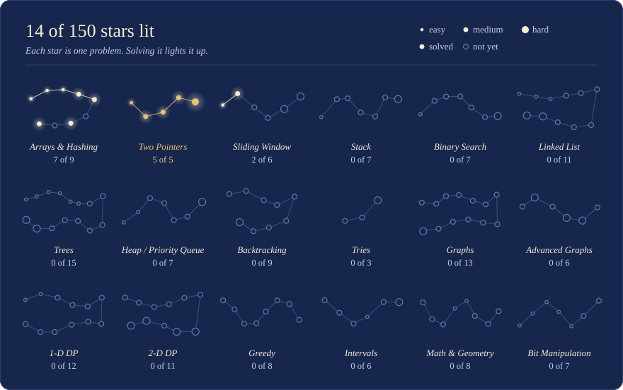

<!-- Generated by scripts/build.py. Edit that file, not this one. -->

<p align="center">
  
</p>

My Python solutions to the [NeetCode 150](https://neetcode.io/practice). Every solution starts with a short note, in plain words, on why it works.

## The star map

Every problem is a star, and every category is a constellation. A solved problem lights its star. A bigger star is a harder problem.

<p align="center">
  
</p>

**14 of 150 solved.** Easy 5 of 28, Medium 8 of 101, Hard 1 of 21.

## The problems

★ is solved and links to the solution. ☆ is still dark.

<details>
<summary><b>Arrays &amp; Hashing</b> &nbsp;·&nbsp; 7 of 9</summary>

Folder: [`01-arrays-hashing`](01-arrays-hashing/)

| | # | Problem | Difficulty |
|:-:|--:|---|---|
| ★ | 217 | [Contains Duplicate](01-arrays-hashing/0217_contains_duplicate.py) | Easy |
| ★ | 242 | [Valid Anagram](01-arrays-hashing/0242_valid_anagram.py) | Easy |
| ★ | 1 | [Two Sum](01-arrays-hashing/0001_two_sum.py) | Easy |
| ★ | 49 | [Group Anagrams](01-arrays-hashing/0049_group_anagrams.py) | Medium |
| ★ | 347 | [Top K Frequent Elements](01-arrays-hashing/0347_top_k_frequent_elements.py) | Medium |
| ☆ | 271 | Encode and Decode Strings | Medium |
| ★ | 238 | [Product of Array Except Self](01-arrays-hashing/0238_product_of_array_except_self.py) | Medium |
| ☆ | 36 | Valid Sudoku | Medium |
| ★ | 128 | [Longest Consecutive Sequence](01-arrays-hashing/0128_longest_consecutive_sequence.py) | Medium |

</details>

<details>
<summary><b>Two Pointers</b> &nbsp;·&nbsp; 5 of 5 ★</summary>

Folder: [`02-two-pointers`](02-two-pointers/)

| | # | Problem | Difficulty |
|:-:|--:|---|---|
| ★ | 125 | [Valid Palindrome](02-two-pointers/0125_valid_palindrome.py) | Easy |
| ★ | 167 | [Two Sum II - Input Array Is Sorted](02-two-pointers/0167_two_sum_ii_input_array_is_sorted.py) | Medium |
| ★ | 15 | [3Sum](02-two-pointers/0015_3sum.py) | Medium |
| ★ | 11 | [Container With Most Water](02-two-pointers/0011_container_with_most_water.py) | Medium |
| ★ | 42 | [Trapping Rain Water](02-two-pointers/0042_trapping_rain_water.py) | Hard |

</details>

<details>
<summary><b>Sliding Window</b> &nbsp;·&nbsp; 2 of 6</summary>

Folder: [`03-sliding-window`](03-sliding-window/)

| | # | Problem | Difficulty |
|:-:|--:|---|---|
| ★ | 121 | [Best Time to Buy and Sell Stock](03-sliding-window/0121_best_time_to_buy_and_sell_stock.py) | Easy |
| ★ | 3 | [Longest Substring Without Repeating Characters](03-sliding-window/0003_longest_substring_without_repeating_characters.py) | Medium |
| ☆ | 424 | Longest Repeating Character Replacement | Medium |
| ☆ | 567 | Permutation in String | Medium |
| ☆ | 76 | Minimum Window Substring | Hard |
| ☆ | 239 | Sliding Window Maximum | Hard |

</details>

<details>
<summary><b>Stack</b> &nbsp;·&nbsp; 0 of 7</summary>

Folder: [`04-stack`](04-stack/)

| | # | Problem | Difficulty |
|:-:|--:|---|---|
| ☆ | 20 | Valid Parentheses | Easy |
| ☆ | 155 | Min Stack | Medium |
| ☆ | 150 | Evaluate Reverse Polish Notation | Medium |
| ☆ | 22 | Generate Parentheses | Medium |
| ☆ | 739 | Daily Temperatures | Medium |
| ☆ | 853 | Car Fleet | Medium |
| ☆ | 84 | Largest Rectangle in Histogram | Hard |

</details>

<details>
<summary><b>Binary Search</b> &nbsp;·&nbsp; 0 of 7</summary>

Folder: [`05-binary-search`](05-binary-search/)

| | # | Problem | Difficulty |
|:-:|--:|---|---|
| ☆ | 704 | Binary Search | Easy |
| ☆ | 74 | Search a 2D Matrix | Medium |
| ☆ | 875 | Koko Eating Bananas | Medium |
| ☆ | 153 | Find Minimum in Rotated Sorted Array | Medium |
| ☆ | 33 | Search in Rotated Sorted Array | Medium |
| ☆ | 981 | Time Based Key-Value Store | Medium |
| ☆ | 4 | Median of Two Sorted Arrays | Hard |

</details>

<details>
<summary><b>Linked List</b> &nbsp;·&nbsp; 0 of 11</summary>

Folder: [`06-linked-list`](06-linked-list/)

| | # | Problem | Difficulty |
|:-:|--:|---|---|
| ☆ | 206 | Reverse Linked List | Easy |
| ☆ | 21 | Merge Two Sorted Lists | Easy |
| ☆ | 141 | Linked List Cycle | Easy |
| ☆ | 143 | Reorder List | Medium |
| ☆ | 19 | Remove Nth Node From End of List | Medium |
| ☆ | 138 | Copy List with Random Pointer | Medium |
| ☆ | 2 | Add Two Numbers | Medium |
| ☆ | 287 | Find the Duplicate Number | Medium |
| ☆ | 146 | LRU Cache | Medium |
| ☆ | 23 | Merge k Sorted Lists | Hard |
| ☆ | 25 | Reverse Nodes in k-Group | Hard |

</details>

<details>
<summary><b>Trees</b> &nbsp;·&nbsp; 0 of 15</summary>

Folder: [`07-trees`](07-trees/)

| | # | Problem | Difficulty |
|:-:|--:|---|---|
| ☆ | 226 | Invert Binary Tree | Easy |
| ☆ | 104 | Maximum Depth of Binary Tree | Easy |
| ☆ | 543 | Diameter of Binary Tree | Easy |
| ☆ | 110 | Balanced Binary Tree | Easy |
| ☆ | 100 | Same Tree | Easy |
| ☆ | 572 | Subtree of Another Tree | Easy |
| ☆ | 235 | Lowest Common Ancestor of a Binary Search Tree | Medium |
| ☆ | 102 | Binary Tree Level Order Traversal | Medium |
| ☆ | 199 | Binary Tree Right Side View | Medium |
| ☆ | 1448 | Count Good Nodes in Binary Tree | Medium |
| ☆ | 98 | Validate Binary Search Tree | Medium |
| ☆ | 230 | Kth Smallest Element in a BST | Medium |
| ☆ | 105 | Construct Binary Tree from Preorder and Inorder Traversal | Medium |
| ☆ | 124 | Binary Tree Maximum Path Sum | Hard |
| ☆ | 297 | Serialize and Deserialize Binary Tree | Hard |

</details>

<details>
<summary><b>Heap / Priority Queue</b> &nbsp;·&nbsp; 0 of 7</summary>

Folder: [`08-heap-priority-queue`](08-heap-priority-queue/)

| | # | Problem | Difficulty |
|:-:|--:|---|---|
| ☆ | 703 | Kth Largest Element in a Stream | Easy |
| ☆ | 1046 | Last Stone Weight | Easy |
| ☆ | 973 | K Closest Points to Origin | Medium |
| ☆ | 215 | Kth Largest Element in an Array | Medium |
| ☆ | 621 | Task Scheduler | Medium |
| ☆ | 355 | Design Twitter | Medium |
| ☆ | 295 | Find Median from Data Stream | Hard |

</details>

<details>
<summary><b>Backtracking</b> &nbsp;·&nbsp; 0 of 9</summary>

Folder: [`09-backtracking`](09-backtracking/)

| | # | Problem | Difficulty |
|:-:|--:|---|---|
| ☆ | 78 | Subsets | Medium |
| ☆ | 39 | Combination Sum | Medium |
| ☆ | 40 | Combination Sum II | Medium |
| ☆ | 46 | Permutations | Medium |
| ☆ | 90 | Subsets II | Medium |
| ☆ | 79 | Word Search | Medium |
| ☆ | 131 | Palindrome Partitioning | Medium |
| ☆ | 17 | Letter Combinations of a Phone Number | Medium |
| ☆ | 51 | N-Queens | Hard |

</details>

<details>
<summary><b>Tries</b> &nbsp;·&nbsp; 0 of 3</summary>

Folder: [`10-tries`](10-tries/)

| | # | Problem | Difficulty |
|:-:|--:|---|---|
| ☆ | 208 | Implement Trie (Prefix Tree) | Medium |
| ☆ | 211 | Design Add and Search Words Data Structure | Medium |
| ☆ | 212 | Word Search II | Hard |

</details>

<details>
<summary><b>Graphs</b> &nbsp;·&nbsp; 0 of 13</summary>

Folder: [`11-graphs`](11-graphs/)

| | # | Problem | Difficulty |
|:-:|--:|---|---|
| ☆ | 200 | Number of Islands | Medium |
| ☆ | 695 | Max Area of Island | Medium |
| ☆ | 133 | Clone Graph | Medium |
| ☆ | 286 | Walls and Gates | Medium |
| ☆ | 994 | Rotting Oranges | Medium |
| ☆ | 417 | Pacific Atlantic Water Flow | Medium |
| ☆ | 130 | Surrounded Regions | Medium |
| ☆ | 207 | Course Schedule | Medium |
| ☆ | 210 | Course Schedule II | Medium |
| ☆ | 261 | Graph Valid Tree | Medium |
| ☆ | 323 | Number of Connected Components in an Undirected Graph | Medium |
| ☆ | 684 | Redundant Connection | Medium |
| ☆ | 127 | Word Ladder | Hard |

</details>

<details>
<summary><b>Advanced Graphs</b> &nbsp;·&nbsp; 0 of 6</summary>

Folder: [`12-advanced-graphs`](12-advanced-graphs/)

| | # | Problem | Difficulty |
|:-:|--:|---|---|
| ☆ | 743 | Network Delay Time | Medium |
| ☆ | 332 | Reconstruct Itinerary | Hard |
| ☆ | 1584 | Min Cost to Connect All Points | Medium |
| ☆ | 778 | Swim in Rising Water | Hard |
| ☆ | 269 | Alien Dictionary | Hard |
| ☆ | 787 | Cheapest Flights Within K Stops | Medium |

</details>

<details>
<summary><b>1-D Dynamic Programming</b> &nbsp;·&nbsp; 0 of 12</summary>

Folder: [`13-1d-dp`](13-1d-dp/)

| | # | Problem | Difficulty |
|:-:|--:|---|---|
| ☆ | 70 | Climbing Stairs | Easy |
| ☆ | 746 | Min Cost Climbing Stairs | Easy |
| ☆ | 198 | House Robber | Medium |
| ☆ | 213 | House Robber II | Medium |
| ☆ | 5 | Longest Palindromic Substring | Medium |
| ☆ | 647 | Palindromic Substrings | Medium |
| ☆ | 91 | Decode Ways | Medium |
| ☆ | 322 | Coin Change | Medium |
| ☆ | 152 | Maximum Product Subarray | Medium |
| ☆ | 139 | Word Break | Medium |
| ☆ | 300 | Longest Increasing Subsequence | Medium |
| ☆ | 416 | Partition Equal Subset Sum | Medium |

</details>

<details>
<summary><b>2-D Dynamic Programming</b> &nbsp;·&nbsp; 0 of 11</summary>

Folder: [`14-2d-dp`](14-2d-dp/)

| | # | Problem | Difficulty |
|:-:|--:|---|---|
| ☆ | 62 | Unique Paths | Medium |
| ☆ | 1143 | Longest Common Subsequence | Medium |
| ☆ | 309 | Best Time to Buy and Sell Stock with Cooldown | Medium |
| ☆ | 518 | Coin Change II | Medium |
| ☆ | 494 | Target Sum | Medium |
| ☆ | 97 | Interleaving String | Medium |
| ☆ | 329 | Longest Increasing Path in a Matrix | Hard |
| ☆ | 115 | Distinct Subsequences | Hard |
| ☆ | 72 | Edit Distance | Medium |
| ☆ | 312 | Burst Balloons | Hard |
| ☆ | 10 | Regular Expression Matching | Hard |

</details>

<details>
<summary><b>Greedy</b> &nbsp;·&nbsp; 0 of 8</summary>

Folder: [`15-greedy`](15-greedy/)

| | # | Problem | Difficulty |
|:-:|--:|---|---|
| ☆ | 53 | Maximum Subarray | Medium |
| ☆ | 55 | Jump Game | Medium |
| ☆ | 45 | Jump Game II | Medium |
| ☆ | 134 | Gas Station | Medium |
| ☆ | 846 | Hand of Straights | Medium |
| ☆ | 1899 | Merge Triplets to Form Target Triplet | Medium |
| ☆ | 763 | Partition Labels | Medium |
| ☆ | 678 | Valid Parenthesis String | Medium |

</details>

<details>
<summary><b>Intervals</b> &nbsp;·&nbsp; 0 of 6</summary>

Folder: [`16-intervals`](16-intervals/)

| | # | Problem | Difficulty |
|:-:|--:|---|---|
| ☆ | 57 | Insert Interval | Medium |
| ☆ | 56 | Merge Intervals | Medium |
| ☆ | 435 | Non-overlapping Intervals | Medium |
| ☆ | 252 | Meeting Rooms | Easy |
| ☆ | 253 | Meeting Rooms II | Medium |
| ☆ | 1851 | Minimum Interval to Include Each Query | Hard |

</details>

<details>
<summary><b>Math &amp; Geometry</b> &nbsp;·&nbsp; 0 of 8</summary>

Folder: [`17-math-geometry`](17-math-geometry/)

| | # | Problem | Difficulty |
|:-:|--:|---|---|
| ☆ | 48 | Rotate Image | Medium |
| ☆ | 54 | Spiral Matrix | Medium |
| ☆ | 73 | Set Matrix Zeroes | Medium |
| ☆ | 202 | Happy Number | Easy |
| ☆ | 66 | Plus One | Easy |
| ☆ | 50 | Pow(x, n) | Medium |
| ☆ | 43 | Multiply Strings | Medium |
| ☆ | 2013 | Detect Squares | Medium |

</details>

<details>
<summary><b>Bit Manipulation</b> &nbsp;·&nbsp; 0 of 7</summary>

Folder: [`18-bit-manipulation`](18-bit-manipulation/)

| | # | Problem | Difficulty |
|:-:|--:|---|---|
| ☆ | 136 | Single Number | Easy |
| ☆ | 191 | Number of 1 Bits | Easy |
| ☆ | 338 | Counting Bits | Easy |
| ☆ | 190 | Reverse Bits | Easy |
| ☆ | 268 | Missing Number | Easy |
| ☆ | 371 | Sum of Two Integers | Medium |
| ☆ | 7 | Reverse Integer | Medium |

</details>

## How the repo is laid out

```
01-arrays-hashing/        one folder per category, in NeetCode's roadmap order
    0001_two_sum.py       one file per problem: <LeetCode number>_<title>.py
assets/                   the banner and the star map
scripts/build.py          redraws the star map and rewrites the READMEs
TEMPLATE.py               the starting point for a new solution
```

Nothing is ticked by hand. After adding a solution, run `python scripts/build.py` and the star map, this page and the folder pages update themselves.
